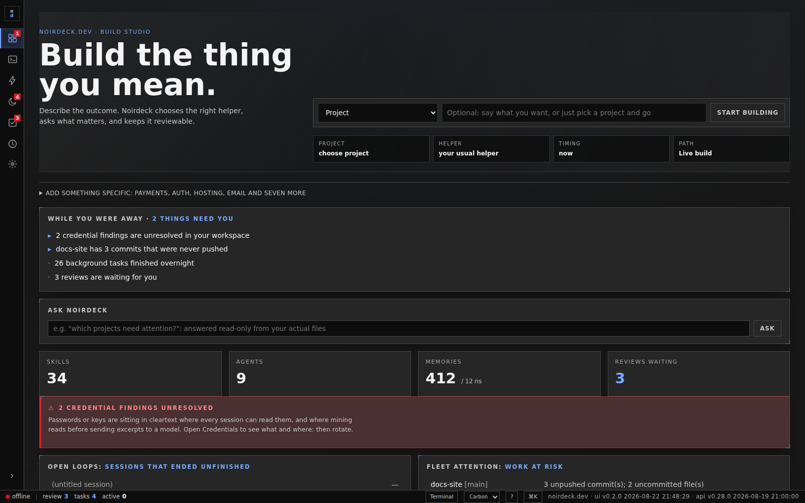
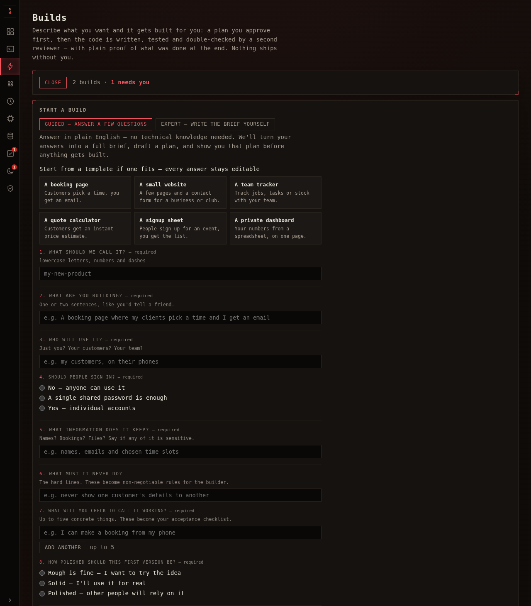
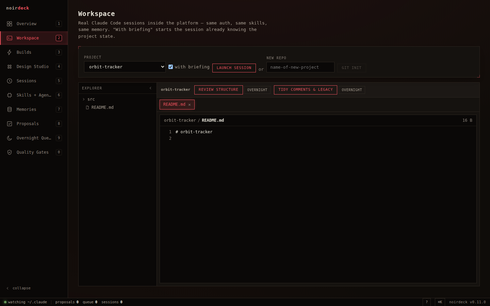

# noirdeck.dev

**A local build studio for making great software with AI.** noirdeck.dev gives
non-experts a plain-English front door and gives power users the pro controls
underneath: project-aware briefs, polished live work, multi-runtime coding
sessions, autonomous pipelines with enforced guardrails, all at
`http://127.0.0.1:4747` on your own machine.

> Mono Dark by default; nine more themes, including Calm Pro, one switch away.



## What it does

**Starts with what you want to build**
- Reads `~/.claude` — skills, agents, memory namespaces, session history — and
  `~/projects` (the git fleet), refreshed by a filesystem event stream (SSE).
- **Build studio**: Home starts with "build the thing you mean." Pick a project
  and type the outcome; noirdeck routes you to live work, design, background
  tasks or Ask without making you hunt through views.
- **Add essentials**: click one of the top ten product needs solo builders ask
  for most — payments, auth, domains, hosting, database, email, uploads,
  analytics, admin, release — answer a few practical questions, then send a
  clean guarded brief to live work or background tasks. Turn on memories +
  preferences when you want Noirdeck to suggest the model/tool method you have
  used here before.
- **The morning digest**: "while you were away" in plain English — what finished
  overnight, what's stuck with a question for you, what's waiting on your
  approval, when your last *verified* backup ran, and what the automation spent.
  Every line assembled deterministically from state, never by a model.
- **Ask Noirdeck**: type a question ("which projects need attention?") and
  a read-only session answers it from your actual files — its tool set is
  Read/Grep/Glob only, so it *cannot* change anything while answering.
- Estate overview: stat tiles, open loops (sessions that ended unfinished), fleet
  attention (uncommitted/unpushed work), follow-on radar, session history
  intelligence over every prompt ever typed.

**Works like an IDE**
- VS Code-style shell: activity bar (pops out to a labelled sidebar, `Ctrl+B`),
  status bar with live telemetry (stream state, pending approvals, backup age),
  intent-aware command palette (`Ctrl+K`), quick keys (`1`–`0` views, `?` cheat
  sheet with the full Claude Code reference, verified against the installed CLI).
- Work: real CLI sessions in the browser (PTY + xterm) for Claude, Codex,
  Ollama local models, or configured custom tools. Pick where, who, and an
  optional model; remember your usual choice; create run-later tasks; and
  **switch** a live session to another model or CLI using an automatic handoff
  brief.
- Project file explorer and read-only file tabs with syntax highlighting.
  Sessions can be **paused across restarts and resumed later**; Claude sessions
  resume the exact conversation when a transcript id is available.
- Views deep-link (`#builds`, `#queue`…): refresh, bookmarks and the back button
  keep your place.

**Builds software for you — no code knowledge required**
- **Guided Build**: pick a **recipe card** (a booking page, a team tracker, a
  quote calculator…) or answer a short plain-English interview; the tool compiles
  a professional brief, plans first, and **parks for your approval** — nothing is
  built until you approve the plan in plain English. It finishes with your own
  acceptance checklist and a deterministic evidence pack (commits, tests, gates)
  assembled by code, not a model.
- **Try it**: when a finished build has a web page, a *try it — see it working*
  button opens the actual app in a sandboxed frame, right on the build card.
  You judge software by using it, not by reading a report.
- **Builds (expert)**: full brief in → code-ready software out. Five phases
  (plan → build → test → review → finish) with per-phase model routing, QA gates
  run *between* phases outside the LLM, crash-nets, and resume from the last
  completed phase. Stops at code-ready. Never ships.
- **Run later**: ticket-shaped tasks run one at a time through the selected
  model/tool without opening a live terminal; anything uncertain parks as a
  question.
- **Design**: capture a design from an existing project or write a brief →
  three parallel visual directions inside one of six ready-to-go UI kits:
  Landing Page, Dashboard, Booking Flow, Shopfront, Admin Portal, or Portfolio.
  Sandboxed live mocks → human Apply gate.

**Improves itself quietly, and protects its own memory**
- **Improve**: a *local* model (via Ollama — zero cloud calls, zero cost) quietly
  proposes docstring/comment/README improvements on branches, inside a trust
  cage: temporary worktree, AST-verified that executable code is unchanged, test
  gate, human merge. It **learns from your decisions** — kinds you keep
  discarding go quiet, per repo. Skills and memory notes can be targets too,
  each individually armed with an expiry, output only via proposals.
- **Miner + hygiene**: mines session history for skill gaps and drafts them as
  proposals; finds duplicate/oversized memory notes and proposes merges.
  Originals are never deleted by automation.
- **The Vault**: nightly encrypted offsite backup (restic) of your memories,
  skills, agents, rules and the noirdeck state — plus bundles of any repo with
  unpushed work — with an actual **restore test**, byte-for-byte verified. The
  status bar shows time since the last *verified* restore, because a backup that
  has never been restored is a hope, not a backup.

**Every applied change is reversible**
- Approving a proposal snapshots what it replaces. One click reverts it —
  restoring the previous content or removing the file the approval created — and
  it refuses to clobber hand-edits made since, unless you confirm. Fear of
  breaking things is the real barrier for non-experts; undo removes it.

## Cheap to run, by design

The harness is code, not model calls: the dashboard, digest, QA gates, evidence
packs, hygiene scans and briefings all cost **zero tokens**. Where models do run,
the spend is engineered:

- **Weight-routed tasks** — small tasks get one cheap session; heavy ones
  (architecture, migrations, security, long briefs) automatically stage
  *plan → build → check*: a thinking model plans in a **read-only cage** (it
  literally cannot edit), a cheaper model executes the brief, and a review model
  checks once. A failed plan falls back to single-session — staging never costs
  you a night.
- **Context packs** — the harness computes each project's briefing (layout, test
  command, recent commits, dirty state, memory index) *in code* and prepends it,
  so sessions skip their token-hungry discovery wander.
- **Reviews only when they earn it** — one deterministic rule decides whether a
  paid review pass can add value: security-flagged paths always review, anything
  unmeasurable reviews (fail-safe), and small clean changes with green gates
  skip it — logged, never silent.
- **A visible bill** — the digest reports what automation spent, daily, and
  arming contracts hard-cap tokens per run.

## The safety model

Four layers, all fail-closed:

1. **Enforced guardrails** — every headless pipeline session launches with a
   PreToolUse hook (`noirdeck/pipeline_guard.py`, shipped inside the package) that denies `git push`, publishing,
   deploys, kubernetes/terraform mutation, and remote access *before execution*.
   Not a prompt instruction — a harness boundary, verified against a live session.
2. **Propose → approve → revert** — the only write path into `~/.claude` is
   proposal approval in the UI, allowlisted to `skills/` and one memory
   namespace, traversal-checked, audited, and reversible after the fact.
3. **Arming contracts** — autonomous subsystems (overnight, mining, improve)
   need the env master flag *and* a live contract: expiring, task-budgeted,
   token-budgeted, revocable, re-checked before every task. An armed system
   disarms itself.
4. **Browser boundary** — binds `127.0.0.1` only, with Host + Origin allowlists
   against DNS rebinding and cross-origin WebSocket hijack (the Work WS is
   shell-equivalent; never tunnel it without auth). Mining batches are redacted
   before model use. Live Work sessions use the provider behavior of the
   selected CLI: Ollama stays local; Claude/Codex may send prompts and handoff
   context through their own authenticated CLIs. Zero external assets in the UI.

Every state-changing action lands in an audit log (UTC, actor, action, detail),
including what the autonomous subsystems did while you slept.

## Prerequisites

- **[Claude Code](https://claude.com/claude-code)** installed and authenticated —
  noirdeck reads `~/.claude`, uses it as the estate source of truth, and shells
  out to `claude` for Claude sessions and Claude-backed pipelines. Startup fails
  closed if `~/.claude` doesn't exist.
- **Python 3.12+**. Node 22+ only if you build the UI from source.
- Pipeline model IDs default to the author's routing (`claude-fable-5` for planning,
  `claude-sonnet-5` for building, `claude-opus-4-8` for review). If your install
  doesn't resolve those ids, override with `NOIRDECK_MODEL_THINK` /
  `NOIRDECK_MODEL_BUILD` / `NOIRDECK_MODEL_REVIEW`.
- Optional: **Codex CLI** for Codex Work sessions and run-later tasks.
- Optional: **[Ollama](https://ollama.com)** with a local code model for the
  Improve engine and Work's `Ollama local` tool.

## Work quick guide

1. Choose **where**: a repo.
2. Choose **who**: Claude, Codex, Ollama local, or a configured custom CLI. If a
   tool is marked "not found", install it or set its `NOIRDECK_*_BIN`
   environment variable.
3. Optionally choose a model, or leave the field blank for that tool's default.
   Ollama suggestions come from the tags already pulled locally.
4. Turn on **suggest method** when you want noirdeck.dev to check saved
   preferences, recent runs, handoff packs and memory notes. It can say "you
   used this method before — reuse it?" while still letting you choose different.
5. Use **start live** for an interactive terminal, or **run later** to create work
   without opening a terminal tab.
6. To switch tools mid-work, select the active session and use **switch to**.
   Noirdeck opens a new session in the same repo with a recent terminal handoff
   brief. Enable **close source** when you want the new runner to fully replace
   the old one.
7. Codex may ask whether you trust the repo. That prompt is from Codex itself;
   choose "Yes" only for repos you trust.

Useful runtime env vars:

- `NOIRDECK_CODEX_BIN`, `NOIRDECK_DEFAULT_CODEX_MODEL`, `NOIRDECK_CODEX_MODELS`
- `NOIRDECK_OLLAMA_BIN`, `NOIRDECK_DEFAULT_OLLAMA_MODEL`, `NOIRDECK_OLLAMA_MODELS`
- `NOIRDECK_GROK_BIN`, `NOIRDECK_DEFAULT_GROK_MODEL`, `NOIRDECK_GROK_MODELS`

## Install it

```bash
pipx install noirdeck   # or: uv tool install noirdeck
noirdeck                # starts the console and opens your browser
```

That is the whole install: the web UI ships inside the package, the recurring
jobs run in-process (no systemd required, works the same on macOS), and state
lives in your data directory rather than a checkout.

```bash
noirdeck doctor         # what's set up, what's missing, and why it matters
noirdeck serve --port 4800 --no-open
noirdeck run improve    # run one scheduled job now, in the foreground
```

### From source

```bash
python3 -m venv .venv && .venv/bin/pip install -r backend/requirements.txt
cd frontend && npm install && npm run build && cd ..
.venv/bin/uvicorn noirdeck.main:app --app-dir backend --port 4747
# optional: systemd user units (a source checkout uses timers, not the
# in-process scheduler — running both would fire every job twice)
mkdir -p ~/.config/systemd/user && cp ops/noirdeck*.{service,timer} ~/.config/systemd/user/
systemctl --user daemon-reload && systemctl --user enable --now noirdeck.service
```

First run is deliberately quiet: everything autonomous ships **disarmed**. You
get the dashboard, workspace, digest and builds immediately; overnight runs,
mining and the improver each need you to arm a contract in the Run later view first.

Config (env): `NOIRDECK_CLAUDE_DIR` (default `~/.claude`), `NOIRDECK_PROJECTS_DIR`
(`~/projects`), `NOIRDECK_DB_PATH`, `NOIRDECK_PRIMARY_NAMESPACE` (defaults to your
home-directory namespace), and the master arming flags `NOIRDECK_MINING_ARMED` /
`NOIRDECK_OVERNIGHT_ARMED` / `NOIRDECK_IMPROVER_ARMED` (default **off**).

State: single SQLite file (WAL, additive-only migrations) — `data/noirdeck.db` in a
source checkout, `~/.local/share/noirdeck/noirdeck.db` when installed.
Set `NOIRDECK_SCHEDULER=off|on` to override where the recurring jobs run.

## Development

```bash
.venv/bin/python -m pytest backend/tests -q   # full suite
cd frontend && npm run build                   # SPA build
```

Stack: FastAPI + SQLite, React 18 + Vite, xterm.js, server-owned CLI runners
with pinned/default model IDs per task class. UI meets WCAG 2.1 AA: full keyboard
operability, focus management and dialog traps, screen-reader landmarks and
labels, AA contrast throughout, `prefers-reduced-motion` respected.



**Eight built-in themes** — noir (default), instrument, aurora, brutalist,
editorial, botanical, swiss, neo-material — switchable from the status bar,
every one verified to WCAG AA contrast.



## Keyboard

| Key | Action |
|-----|--------|
| `1` – `0` | jump between views |
| `Ctrl+K` | command palette — skills, shortcuts, tips |
| `Ctrl+B` | expand / collapse the sidebar |
| `?` | quick keys + full Claude Code reference |
| `Esc` | close overlays |

## License

MIT — see [LICENSE](LICENSE).
